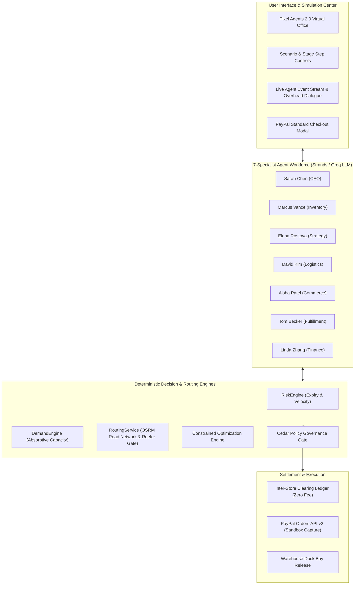

# ReStockAI 2.0 — Autonomous Network Inventory Intelligence & Recovery

> **Submission for the PayPal AI Hackathon 2026**  
> *Transforming retail food waste and inventory stockouts into profitable, network-first autonomous commerce.*

---

## 1. Executive Summary

Every year, multi-location grocery chains, supermarket networks, and quick-commerce dark stores lose billions of dollars to perishable food waste while neighboring branches suffer from critical stockouts. Traditional retail software operates in departmental silos: inventory managers mark down expiring stock locally at heavy losses, while logistics and store operations order emergency replenishment from suppliers with high rush fees.

**ReStockAI 2.0** introduces an autonomous multi-agent operating system that prioritizes **internal multi-branch inventory redistribution** as the primary economic use case, keeping **external B2B liquidation via PayPal Sandbox** as a high-velocity fallback when internal redistribution is not economically feasible.

---

## 2. System Architecture



### Technology Stack
- **Backend Framework:** FastAPI 0.111.0 (Python 3.11+) with asynchronous WebSockets and REST APIs.
- **Frontend Framework:** React 19, TypeScript, Vite 8.3, Tailwind CSS v4, Lucide Icons.
- **AI Agent Framework:** Strands Multi-Agent Orchestrator powered by Groq LLM API (`openai/gpt-oss-120b` / `llama-3.3-70b-versatile`).
- **Commercial Payments:** PayPal Orders API v2 (POST /v2/checkout/orders, POST /v2/checkout/orders/{id}/capture) with standard PayPal JavaScript SDK.
- **Authorization Governance:** Cedar Policy Engine (`cedarpy`) enforcing role-based limits and high-value operation gates.
- **Logistics & Routing:** OpenStreetMap / OSRM highway routing integration with calibrated Haversine fallback ($1.25\times$ urban tortuosity).

---

## 3. The Seven-Agent Specialist Workforce

ReStockAI 2.0 features 7 distinct AI employees, each assigned a specific department workstation and clear operational authority:

| Agent # | Specialist | Title | Department | Primary Mandate |
| :---: | :--- | :--- | :--- | :--- |
| **#1** | **Sarah Chen** | CEO / Operations Supervisor | Executive Office | Orchestrates workflow delegation, evaluates Cedar governance policies, reviews final audits. |
| **#2** | **Marcus Vance** | Inventory Risk Specialist | AI Agent Workroom | Scans SKU expiry dates, daily velocity, surplus batches, and shortage deadlines. |
| **#3** | **Elena Rostova** | Recovery Strategy Specialist | AI Agent Workroom | Discovers matching branches, models incremental network value, evaluates trade-offs. |
| **#4** | **David Kim** | Logistics & Route Specialist | AI Agent Workroom | Evaluates carrier rates, cold-chain compatibility, road kilometers, and transit times. |
| **#5** | **Aisha Patel** | Commerce & Markdown Specialist | AI Agent Workroom | Structures B2B recovery orders, manages commercial buyer matching, initiates PayPal invoices. |
| **#6** | **Tom Becker** | Fulfillment & Warehouse Specialist | AI Agent Workroom | Verifies payment/authorization, stages dock bay manifests, releases physical inventory. |
| **#7** | **Linda Zhang** | Finance & Margins Specialist | AI Agent Workroom | Audits inter-branch clearing ledgers, reconciles PayPal gross/fee/net receipts, reports to CEO. |

---

## 4. Four Core Business Scenarios

### Scenario A: Surplus Inventory Rescue (Donor Branch Perspective)
- **Problem:** Store A (Downtown Superstore) has 110 units of Organic Greek Yogurt expiring in 2 days; local velocity is only 4.5 units/day, leaving 90 units at severe spoilage risk.
- **Resolution:** Elena Rostova discovers Store B with high demand (18 units/day). David Kim assigns SwiftReefer Express (3.5T Chilled Van, 12.8 km road).
- **Settlement:** Settled via enterprise inter-store clearing ledger with **zero transaction fees** ($\Delta \text{Revenue} = 0$). Generates **+$280.40** net incremental network value over local markdowns.

### Scenario B: Stockout Prevention (Receiving Branch Perspective)
- **Problem:** Store D (East Branch) faces imminent stockout of Organic Blueberries with only 8 units left and 6.0 hours before empty shelves.
- **Resolution:** System identifies Store A with 55 transferable units above its local safety stock.
- **Settlement:** Dispatches immediate internal transfer arriving in 26 minutes, protecting $174.50 retail margin and saving **+$360.50** compared to emergency supplier rush order fees and lost sales.

### Scenario C: Network-Wide Inventory Balancing
- **Problem:** Simultaneous multi-branch imbalances across 4 stores (surpluses at Stores A and C; acute deficits at Stores B and D).
- **Resolution:** Constrained multi-branch optimization allocates 110 units across 2 optimal routes.
- **Settlement:** Total carrier freight: $90.38, generating **+$613.80** net network economic value.

### Scenario D: External B2B Liquidation Fallback (PayPal Sandbox)
- **Problem:** Perishable whole milk (120 units, 36h expiry) cannot be absorbed internally because regional cold rooms are at 100% capacity.
- **Resolution:** Aisha Patel matches verified secondary commercial buyer *Metro Retail Discount Mart* at $1.80/unit ($216.00 USD total). Cedar policy triggers manager approval.
- **Settlement:** Genuine **PayPal Sandbox Orders API v2** invoice created. Buyer approves in PayPal window, server captures payment with genuine Capture ID, and Linda Zhang reconciles gross ($216.00), PayPal fee ($6.77), and net proceeds ($180.43). Physical fulfillment occurs **only after verified payment capture**.

---

## 5. PayPal Sandbox Orders v2 Architecture

ReStockAI incorporates PayPal Sandbox Orders API v2 with server-authoritative security:

1. **Server-Side Order Creation (`POST /api/payments/paypal/create-order`):**
   - Amount is strictly computed by the server from the verified recovery order record—the frontend cannot tamper with prices.
   - Enforces idempotency via `PayPal-Request-Id` headers.
2. **Buyer Approval via Standard JavaScript SDK:**
   - Standard gold PayPal checkout button rendered directly in the simulation modal.
   - Buyer authenticates in PayPal Sandbox and approves the purchase intent.
3. **Strict Server-Side Capture (`POST /api/payments/paypal/capture`):**
   - Validates that PayPal order status is `COMPLETED`.
   - Validates that captured amount and currency match the expected order total down to the cent.
   - Extracts genuine `paypal_capture_id`, `paypal_fee`, and `net_amount` directly from `seller_receivable_breakdown`.
   - Rejects duplicate capture attempts safely (idempotent).
   - Rejects unapproved orders with genuine HTTP 422 `ORDER_NOT_APPROVED` error from PayPal.
4. **Decoupled Fulfillment:**
   - Fulfillment status remains `UNFULFILLED` until physical warehouse release is authorized by Tom Becker following verified payment capture.

---

## 6. Road-Routing Intelligence Service

Located in [`backend/app/services/routing_service.py`](backend/app/services/routing_service.py):
- **Live OSRM Highway Engine:** Queries OpenStreetMap road network for driving distances and realistic transit durations.
- **Calibrated Haversine Fallback:** When offline or sandboxed, uses great-circle distance with an empirical $1.25\times$ urban tortuosity multiplier and $35\text{ km/h}$ average commercial freight speed.
- **Strict Non-Deceptive Labeling:** Fallback responses explicitly set `is_actual_driving_distance: False`, `routing_engine: "HAVERSINE_CALIBRATED_FALLBACK"`, and emit clear telemetry notes.
- **Cold-Chain Safety Gate:** Verifies active refrigeration support and ensures estimated journey time plus a 4-hour safety margin does not exceed remaining product shelf life.

---

## 7. Quickstart Guide

### Prerequisites
- Python 3.11+
- Node.js 18+ and npm
- PayPal Developer Sandbox Account (for live Scenario D testing)

### 1. Clone & Configure Environment
```bash
git clone https://github.com/your-org/Restock_AI.git
cd Restock_AI

# Copy environment template
cp .env.example .env
```
Edit `.env` to supply your **PayPal Sandbox credentials** and **Groq API key**:
```ini
RESTOCKAI_LLM_PROVIDER=groq
RESTOCKAI_GROQ_API_KEY=your_groq_api_key_here
RESTOCKAI_AGENT_MODEL=llama-3.3-70b-versatile
RESTOCKAI_PAYPAL_CLIENT_ID=your_paypal_sandbox_client_id_here
RESTOCKAI_PAYPAL_CLIENT_SECRET=your_paypal_sandbox_client_secret_here
PAYPAL_MODE=sandbox
PAYPAL_CURRENCY=USD
```

### 2. Backend Setup & Database Seeding
```bash
# Create and activate virtual environment
python -m venv venv

# Windows
venv\Scripts\activate
# macOS/Linux
source venv/bin/activate

# Install backend dependencies
pip install -r backend/requirements.txt

# Seed synthetic retail database
python -m backend.app.services.data_loader

# Start FastAPI development server
uvicorn backend.app.main:app --reload --host 127.0.0.1 --port 8000
```

### 3. Frontend Setup
In a new terminal:
```bash
cd frontend
npm install
npm run dev -- --port 5173
```
Open [http://localhost:5173](http://localhost:5173) in your browser.

---

## 8. Running the Complete Verification Suite

### Automated Backend Tests (158 Tests, 100% Pass Rate)
```bash
# Run full regression suite
pytest backend/tests/ -v
```
All 158 tests covering deterministic risk calculations, demand matching, decision trade-offs, road-routing intelligence, Cedar authorization, Render/PostgreSQL readiness & Alembic migrations, WebSockets, and PayPal Sandbox payments pass with 0 failures.

### Frontend Production Build
```bash
cd frontend
npm run build
```
Executes TypeScript type checking (`tsc -b`) and Vite production bundle generation with 0 errors.

---

## 9. Manual Sandbox Demonstration Steps (Scenario D)

To verify the live PayPal Sandbox payment workflow during a hackathon evaluation:
1. Open the application at [http://localhost:5173](http://localhost:5173) and click **Simulation** in the navigation menu.
2. Under Scenario Selection, choose **Scenario D: External B2B Liquidation Fallback**.
3. Advance through the stages by clicking **Next Step**:
   - **Stage 1 (Inventory Audit):** Marcus Vance identifies 120 units of milk expiring in 36h at Store A.
   - **Stage 2 (Buyer Matching):** Aisha Patel matches *Metro Retail Discount Mart* (100% match).
   - **Stage 3 & 4:** System checks economics and assigns refrigerated transport.
   - **Stage 5 (Order Created):** Aisha structures formal Recovery Order `SIM-ORD-EXT-*` for $216.00 USD.
   - **Stage 6 (Cedar Gate):** Sarah Chen triggers approval; click **Approve Decision** to authorize.
4. **Stage 7 (Settlement / PayPal):** The PayPal checkout modal appears. Click the gold **PayPal** button.
5. In the PayPal Sandbox popup window, sign in using personal PayPal Sandbox buyer credentials.
6. Click **Complete Purchase**.
7. The server captures the payment via PayPal Orders API v2, verifies the `COMPLETED` status, and logs the genuine `capture_id`.
8. The workflow automatically completes **Stage 8 (Fulfillment by Tom Becker)** and **Stage 9 (Financial Reconciliation by Linda Zhang)** with full gross, fee, and net accounting.

---

## 10. Render Cloud Deployment Guide

ReStockAI 2.0 includes a complete Render Blueprint (`render.yaml`) provisioning:
- **`restockai-db`**: Managed PostgreSQL database
- **`restockai-api`**: FastAPI + WebSocket Virtual Office Web Service (`uvicorn --workers 1`)
- **`restockai-web`**: React 19 + Vite Static Site on Render's CDN with SPA routing rewrites

### A. Quick Blueprint Deployment
1. Push your repository to GitHub/GitLab (ensure `.env` and `*.db` remain ignored via `.gitignore`).
2. In the **Render Dashboard**, choose **New + &rarr; Blueprint** and select this repository containing [`render.yaml`](render.yaml).
3. Provide your secret environment variables (`RESTOCKAI_GROQ_API_KEY`, `RESTOCKAI_PAYPAL_CLIENT_ID`, `RESTOCKAI_PAYPAL_CLIENT_SECRET`) when prompted.
4. Once both web services deploy and receive their public `.onrender.com` URLs:
   - On **`restockai-api`**, set `FRONTEND_URL` to your static site URL (e.g. `https://restockai-web.onrender.com`).
   - On **`restockai-web`**, set `VITE_API_BASE_URL` to your backend URL (e.g. `https://restockai-api.onrender.com`), then trigger **Manual Deploy &rarr; Clear build cache & deploy** so Vite bakes the production API/WSS URL into `frontend/dist/`.

### B. Database Migration (SQLite Local &harr; PostgreSQL on Render)
- **URL Handling:** `backend/app/database.py` automatically reads `DATABASE_URL` (normalizing Render's `postgres://` prefix to `postgresql://`), applies connection health checks (`pool_pre_ping=True`, `pool_recycle=300`), and preserves SQLite locally when `DATABASE_URL` is unset.
- **Schema Migrations (Alembic):**
  ```bash
  # Generate PostgreSQL DDL for inspection
  alembic -c backend/alembic.ini upgrade head --sql

  # Apply schema migrations cleanly against target DATABASE_URL
  alembic -c backend/alembic.ini upgrade head
  ```
- **Non-Destructive Startup Seeding:** On Render startup (`uvicorn` with `--workers 1`), FastAPI's `lifespan` ensures schema creation is idempotent and seeds initial store/SKU/logistics data **only** when tables are empty (`RESTOCKAI_RUN_SEED_ON_STARTUP=true`). Existing production records are never overwritten.

### C. Cost & Tier Considerations
- **Free Tier (\$0/mo total for demo evaluation):**
  - Static Site (`restockai-web`): permanently free CDN hosting.
  - Web Service (`restockai-api`, Free): 750 free hours/month, **spins down after 15 min idle** (~50s cold start).
  - Managed PostgreSQL (`restockai-db`, Free): **expires 30 days after creation** (14-day grace period before deletion).
- **Recommended Hackathon / Live Demo Tier (~$13/mo):**
  - Upgrade `restockai-api` to **Starter (\$7/mo)** to keep API and WebSockets warm with zero cold starts, and `restockai-db` to **Basic (\$6/mo)** for permanent PostgreSQL persistence.

### D. Demo Authentication & Security Hardening

ReStockAI 2.0 protects all operational REST routes (`inventory`, `risk`, `decisions`, `transfers`, `outcomes`, `history`, `workflow`, `authorization`, `agent`, `simulation`, `payments`, `office`) and WebSocket streams (`/ws/office`, `/ws`) using hardened session authentication:

1. **Required Environment Variables:**
   - `RESTOCKAI_DEMO_PASSWORD`: Demo access password verified on the backend via constant-time comparison (`POST /api/auth/login`).
   - `RESTOCKAI_SESSION_SECRET`: Cryptographic signing key (`>= 32` characters, distinct from `RESTOCKAI_DEMO_PASSWORD`) validated on startup in production.
   - `RESTOCKAI_SESSION_TTL_MINUTES`: Session lifetime in minutes (`1..480`, default `60`).
   - `FRONTEND_URL`: Exact HTTPS deployed frontend origin (e.g. `https://restockai-web.onrender.com`) configured for credentialed CORS, Origin validation, WebSocket handshakes, and PayPal callback URLs (no localhost fallback in production).
   - `RESTOCKAI_TRUSTED_PROXY_HOPS`: Set to `1` on Render so rate limiting reads the right-most proxy-appended client IP rather than spoofable left-most `X-Forwarded-For` entries (set `0` for direct local development).
2. **Defense-in-Depth Controls:**
   - **Cookies & CSRF:** Production issues `__Host-restockai_session` (`HttpOnly`, `Secure`, `SameSite=None`, `Path=/`). All `POST`/`PUT`/`PATCH`/`DELETE` requests require matching `Origin`, `Content-Type: application/json` for payloads, and a session-bound `X-CSRF-Token` stored in frontend memory.
   - **WebSocket Protection:** Handshakes verify both session cookie and `Origin` before room admission (closing unauthorized requests with `1008`), and logout actively closes bound WebSockets.
   - **Persistence & Production Posture:** Session revocations (`revoked_sessions`) and bounded sliding-window rate limits (`login_attempt_buckets`) persist in Neon PostgreSQL / SQLite across restarts; `/docs`, `/redoc`, and `/openapi.json` are disabled when `RESTOCKAI_ENV=production`.
3. **Signing In (Judges & Reviewers):**
   - Navigate to the deployed frontend URL (unauthenticated users redirect automatically to `/login`), enter the hackathon demo password, and click **Logout** in the top navigation bar when done.
   - Keep `PAYPAL_MODE=sandbox` and `PAYPAL_ALLOW_MOCK=false`, use spend-capped Groq keys, and restrict deployment to controlled hackathon judging without real production customer data.

---

## 11. License & Attributions

This project is licensed under the [MIT License](LICENSE). Third-party attributions and licenses for PayPal SDK, FastAPI, React, Tailwind CSS, Lucide, and OpenStreetMap/OSRM are detailed in the `LICENSE` file.
